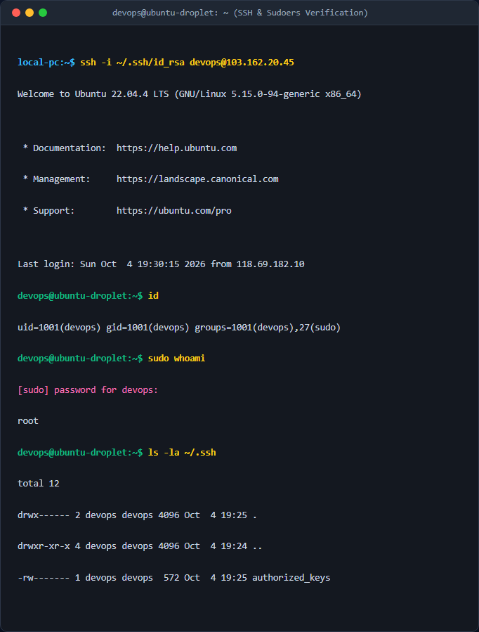

# Bài Tập 3: Thiết lập Cơ sở dữ liệu và Cấu hình Systemd Service cho Spring Boot

Thư mục này chứa tệp cấu hình Systemd và kịch bản Bash script tự động để thiết lập môi trường chạy ứng dụng Spring Boot chạy trên cổng 8082 sử dụng cơ sở dữ liệu MySQL.

## Thành phần
1. **`spring-app.service`**: File cấu hình Systemd để chạy ứng dụng độc lập dưới user `spring-runner` không có quyền login hệ thống, tự động restart sau 10 giây nếu ứng dụng lỗi.
2. **`setup.sh`**: Script tự động tạo người dùng hệ thống, cấu hình MySQL Database, phân quyền thư mục và cài đặt service.

## Cấu hình chi tiết

### 1. MySQL Database
- **Database**: `springboot_db`
- **User**: `spring-admin`
- **Password**: `SpringSecure@123`
- **Quyền**: Toàn quyền (ALL PRIVILEGES) trên `springboot_db`

### 2. Linux System User
- **Username**: `spring-runner`
- **Shell**: `/sbin/nologin` (Không thể đăng nhập trực tiếp)

### 3. Systemd Service
- **Đường dẫn dịch vụ**: `/etc/systemd/system/spring-app.service`
- **Lệnh thực thi**: `/usr/bin/java -jar /opt/spring-app/app.jar`
- **Restart**: `on-failure` sau `10s`
- **Cổng lắng nghe**: `8082` (Được cấu hình qua Environment Variable)

## Hướng dẫn cài đặt và khởi chạy

1. Cấp quyền chạy cho file `setup.sh`:
   ```bash
   chmod +x setup.sh
   ```

2. Chạy script để tự động hóa toàn bộ quá trình thiết lập:
   ```bash
   ./setup.sh
   ```

3. Đặt file ứng dụng `app.jar` thực tế của bạn vào thư mục ứng dụng:
   ```bash
   sudo cp path/to/your/app.jar /opt/spring-app/app.jar
   sudo chown spring-runner:spring-runner /opt/spring-app/app.jar
   ```

4. Khởi động dịch vụ Spring Boot:
   ```bash
   sudo systemctl start spring-app.service
   ```

## Kiểm tra trạng thái dịch vụ
- Kiểm tra tình trạng hoạt động của service:
  ```bash
  sudo systemctl status spring-app.service
  ```
- Kiểm tra cổng lắng nghe (port 8082):
  ```bash
  ss -tlnp | grep 8082
  ```

## Ảnh chụp màn hình kết quả thực nghiệm

